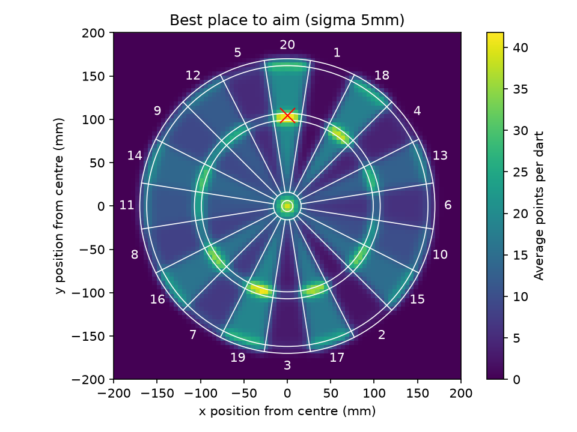
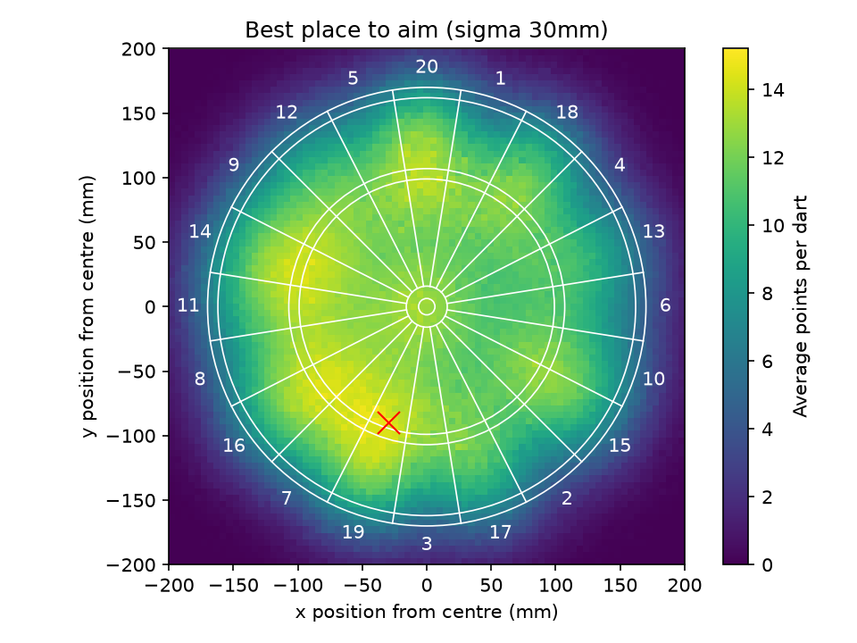
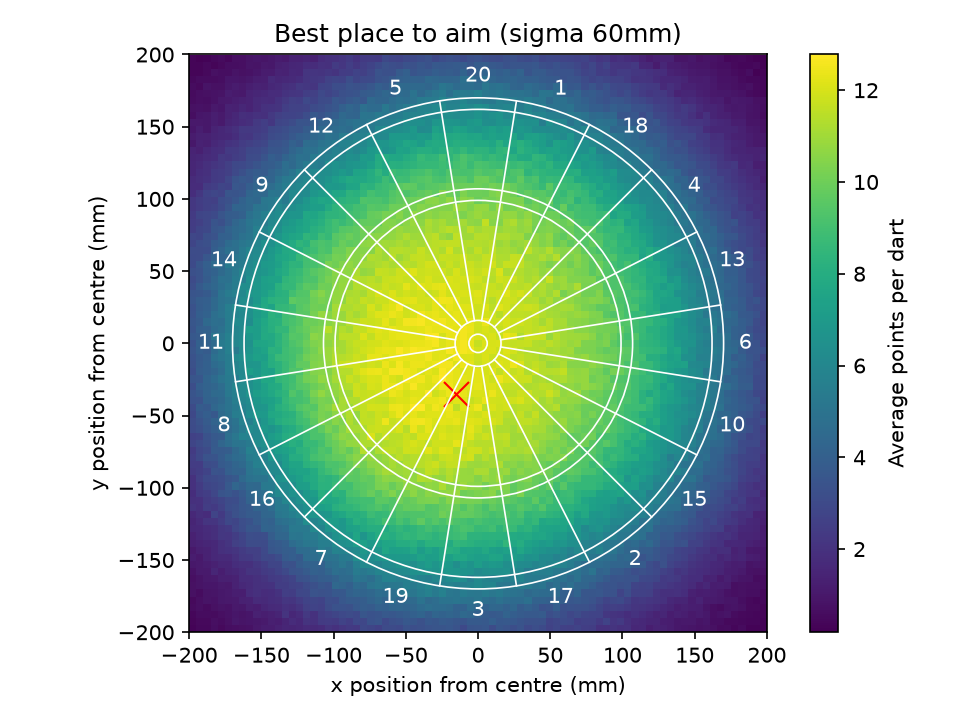

# 🎯 Darts: Where Should You Aim?

Professional darts players aim for the treble 20 as it's the highest scoring point on the board, however most people like myself
aren't professional players. This project simulates thousands of throws to find out where players of different abilities
should actually aim to score the most points possible.

## Key finding

The best place for the pros to aim was, as you would expect, the treble 20. However, once we introduced the element of inaccuracy,
the findings saw that players with less precise aim would score higher on average in and around the treble 19 area, and beginners
would score the most by aiming near the middle of the board.

| Player | Accuracy (sigma) | Best place to aim | Average per dart |
|---|---|---|---|
| Pro | 5 mm | Treble 20 | 41.8 |
| Pub player | 30 mm | Treble 19 area | 15.2 |
| Beginner | 60 mm | Middle, slightly low-left | 12.8 |

| Pro (sigma 5) | Pub player (sigma 30) | Beginner (sigma 60) |
|---|---|---|
|  |  |  |

## Why?

The treble 20 sits between a 5 and a 1, two of the lowest numbers on the board. The bottom-left section of the board holds a very
high average segment value (19, 7, 16, 8), which is why players with less precise aim would on average score noticeably higher there
(15.2 per dart in the treble 19 area compared to 13.8 at the treble 20 for a pub player).

Beginners miss so widely that their main priority is keeping the dart on the board at all, so their best target is near the middle.

## How it works

1. **Board model:** Each dart's landing point is treated as an (x, y) in mm from the bull. Its distance from the centre (Pythagoras)
gives the ring, and its direction (angle) gives the number, so any point on the board can be scored.
2. **Simulating throws:** A dart lands where the player aims plus a random wobble, which is drawn from a normal distribution. Sigma
sets how big this wobble is, portraying a pro (5 mm), a pub player (30 mm) and a beginner (60 mm).
3. **Monte Carlo averages:** One throw is luck, so each aim point is tested with 2000 simulated darts and the scores averaged to measure
how good it really is.
4. **Heatmap:** This is repeated for every point on a 5 mm grid across the board (6561 aim points), and the board is coloured by the
average score.

The first version threw one dart at a time in a loop. Rewriting it to process all the darts at once as NumPy arrays (vectorisation)
made it roughly 11x faster.

## Limitations

- Real throws aren't perfectly round: most players miss more up-and-down than side-to-side. The model assumes the same scatter in every
direction, which isn't strictly true.
- Results vary slightly between runs because of the random nature of the program. Sometimes the output for the best segment to aim for
changes from the treble 19 to the treble 7 between runs, so aim points that score almost the same are effectively tied.
- The three sigma values are estimates I made of typical players, not measured on real throw data. For example, a pro's sigma may actually
be a lot less than 5, and a beginner's could be higher than 60.

## What's next

- [ ] Best checkout route if you never miss
- [ ] Best checkout for a real player who does miss, compared with the pros' checkout charts
- [ ] Measure my own accuracy from real throws and build my personal checkout chart

## Tech

Python · NumPy · matplotlib

## Run it

```bash
pip install -r requirements.txt
python heatmap.py
```

This creates the three heatmap images in the project folder.

## Files

| File | What it does |
|---|---|
| `board.py` | Establishes the dartboard's dimensions, turns where a dart lands into its ring, number and score |
| `simulate.py` | Simulates thousands of throws with a random scatter and averages the scores found |
| `heatmap.py` | Generates a heatmap showing the best place for players of different abilities to aim |

## Author

Jack Lansley: Computer Science & AI student at the University of Sussex.
